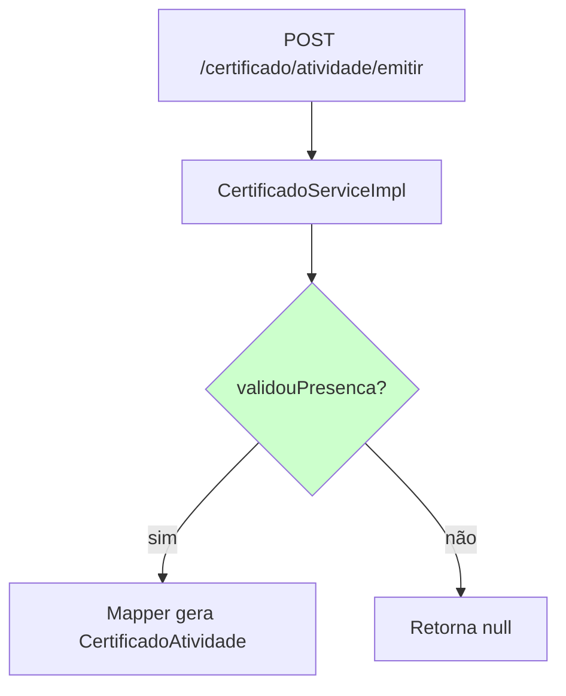

# Criar PR no GitHub

Use esta skill sempre que o usuário pedir para criar um PR (pull request).

## Passos

0. **Revisão obrigatória**: antes de qualquer outro passo, confirme que o subagent `revisor-codigo` revisou as mudanças desta branch e deu veredito `APROVADO` ou `APROVADO COM RESSALVAS`. Se ainda não revisou, acione-o agora (Agent com `subagent_type: revisor-codigo`). Se o veredito for `REPROVADO`, não crie o PR: encaminhe os achados ao agente autor, aguarde as correções e peça nova revisão.

1. **Levante o contexto** (em paralelo):
   - `git status` e `git branch --show-current`
   - `git log <base>..HEAD --oneline` e `git diff <base>...HEAD --stat`, onde `<base>` é a branch principal (`master` neste repo, confirme com `gh repo view --json defaultBranchRef`).
   - Leia o diff completo (`git diff <base>...HEAD`) para entender as mudanças de fato, não só os nomes dos arquivos.
2. **Prepare a branch**:
   - Se estiver na branch principal, crie uma branch nova com nome descritivo (`feat/...`, `fix/...`, `chore/...`, `docs/...`) antes de commitar.
   - Se houver mudanças não commitadas relevantes, pergunte se devem entrar no PR; nunca inclua arquivos não relacionados (ex.: `package-lock.json`, `*.html` soltos) sem confirmação.
   - Após confirmação, faça `git add` apenas dos arquivos aprovados e `git commit` antes de qualquer `git push` ou `gh pr create`.
   - Faça `git push -u origin <branch>` se a branch ainda não estiver no remoto.
3. **Monte o corpo do PR** seguindo o formato abaixo.
4. **Crie o PR sempre com `gh pr create`** (nunca pela web nem pela API direta). Passe o corpo via heredoc:

   ```bash
   gh pr create --base <base> --title "<título>" --body "$(cat <<'EOF'
   <corpo>
   EOF
   )"
   ```

5. Devolva ao usuário a URL do PR retornada pelo comando.

## Título

Curto (até ~70 caracteres), no imperativo e no idioma dos commits do repo (português), por exemplo: `Adiciona validação de presença no certificado`.

## Formato do corpo (nesta ordem)

### 1. Resumo rápido (sempre primeiro)

2 a 4 linhas ou bullets: **o que** mudou e **por que**. Sem rodeios; quem lê só isso deve entender o PR.

### 2. Fluxogramas mermaid

Inclua um ou mais diagramas que ajudem a entender as mudanças, usando blocos ```` ```mermaid ````. Escolha o tipo conforme o caso:

- `flowchart TD/LR`: fluxo de lógica/negócio alterado, ou relação entre camadas/classes afetadas (controller → service → repository).
- `sequenceDiagram`: interação entre componentes ou chamadas externas.
- Se houver comportamento antes/depois, mostre os dois (ou destaque os nós novos/alterados).

Regras: diagramas pequenos e legíveis (no máximo ~10 nós cada); rótulos curtos; destaque o que é novo/alterado (ex.: `style No fill:#cfc`). Se a mudança for puramente trivial (typo, config), um diagrama simples ou uma nota "sem mudança de fluxo" basta.

### 3. Demais mudanças

Lista (bullets) de **todas** as outras alterações que não couberam no resumo/diagramas: arquivos de config, dependências, testes, docs, renomeações, remoções, refactors menores. Agrupe por área quando houver muitas.

### 4. Como testar (opcional, quando fizer sentido)

Comandos ou passos para validar (ex.: `./gradlew test`). Se os testes não foram executados, diga isso explicitamente.

## Rodapé

Termine o corpo com a linha de atribuição exigida pela sessão/ambiente, se houver (ex.: `🤖 Generated with [Claude Code](https://claude.com/claude-code)`).

## Exemplo de corpo

````markdown
## Resumo
Emite certificado apenas quando `validouPresenca()` é verdadeiro, evitando certificados para inscrições sem presença.

## Fluxo


## Outras mudanças
- Testes unitários para os caminhos de `validouPresenca()`
- Ajuste de nome de variável em `CertificadoStaff`

## Como testar
`./gradlew test`

🤖 Generated with [Claude Code](https://claude.com/claude-code)
````

## Cuidados

- Nunca faça `--force` push nem altere a branch principal.
- Não invente mudanças: tudo no PR deve vir do diff real.
- Se `gh` não estiver autenticado (`gh auth status` falhar), avise o usuário e sugira `gh auth login`.
